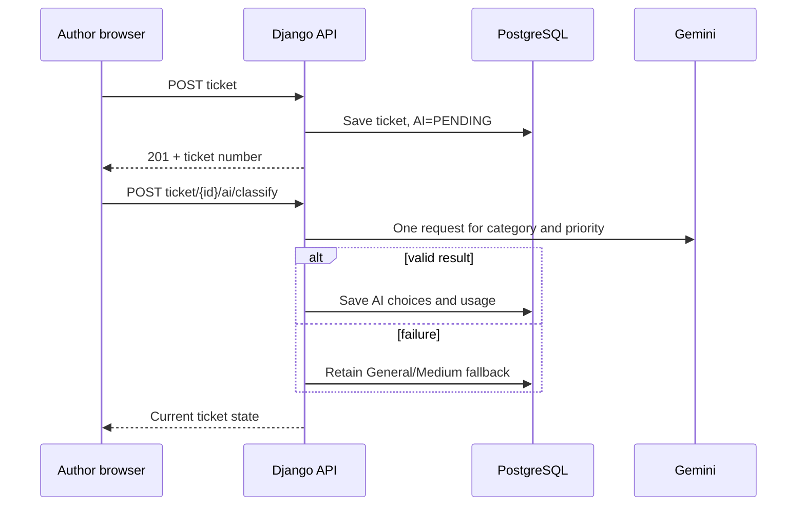

# BookLeaf architecture and API contract

## Components

The Vite/React/TypeScript frontend uses React Router for author and staff routes, TanStack Query for cached API data and eight-second polling, Axios for JWT refresh, and React Hook Form with Zod for login and ticket creation. Django REST Framework is the single API. Its `accounts`, `books`, `tickets`, `ai_services`, and `core` apps own separate concerns. PostgreSQL stores all deployed data; SQLite is a local/test fallback.

The second AI request fits Render Free without a durable worker: author submission returns before any Gemini network call. Staff can retry classification and always reply manually.

## Data and authorization

`User` has an email login and `AUTHOR`/`ADMIN` roles. `AuthorProfile` owns the supplied external author ID. `Book` owns the supplied external book ID and royalty/distribution values. `Ticket` belongs to one author and optionally one of that author's books. `TicketMessage` is public to the conversation; `InternalNote` is staff-only. Author querysets are scoped to their profile and author serializers exclude AI drafts, internal notes, and staff-only fields. Staff routes check role in Django. The reply idempotency key has a database uniqueness constraint.

Staff may progress `OPEN → IN_PROGRESS → RESOLVED → CLOSED`, reopen closed work, and correct classification/priority. A new author message reopens resolved or closed tickets. Timestamp fields track resolution and closure. History is retained.

## API contract

| Endpoint | Role | Purpose |
| --- | --- | --- |
| `POST /api/v1/auth/login/`, `/refresh/`, `/logout/` | Appropriate token | JWT lifecycle |
| `GET /api/v1/auth/me/` | Signed in | Identity and role |
| `GET /api/v1/authors/me/`, `/books/`, `/books/{id}/`, `/dashboard/` | Author | Own account and data |
| `GET, POST /api/v1/tickets/` | Author | Own paginated tickets / create |
| `GET /api/v1/tickets/{id}/` | Author | Own ticket, public fields |
| `GET, POST /api/v1/tickets/{id}/messages/` | Owner or staff | Conversation |
| `POST /api/v1/tickets/{id}/ai/classify/` | Owner | Initial classification |
| `GET /api/v1/admin/dashboard/`, `/tickets/` | Staff | Counts and filtered queue |
| `GET, PATCH /api/v1/admin/tickets/{id}/` | Staff | Detail and validated changes |
| `POST /api/v1/admin/tickets/{id}/assign/` | Staff | Assign to self |
| `GET, POST /api/v1/admin/tickets/{id}/notes/` | Staff | Private notes |
| `POST /api/v1/admin/tickets/{id}/reply/` | Staff | Send reviewed text |
| `POST /api/v1/admin/tickets/{id}/ai/draft/`, `/retry-classification/` | Staff | AI assistance |

Queue parameters are `search`, `status`, `category`, `priority`, `from`, `to`, `assigned=me`, `sort=newest|oldest|priority|oldest_unresolved`, and `page`. Invalid choices return 400.

## AI, security, and operations

Classification uses one schema-validated response for six categories and four priorities. Failure preserves `GENERAL` and `MEDIUM`. Manual category and priority overrides are tracked separately and retained during retries. Drafting selects one relevant local knowledge-base section plus book figures and recent messages. The prompt treats ticket text as untrusted and forbids unverified action claims. Drafts stay staff-only until an edited reply is sent separately. SDK timeout, explicit AI endpoint throttling, sanitized errors, model/usage metadata and token-conscious prompts control risk and free-tier use.

Cloudflare Pages serves the SPA, Render Free runs Gunicorn, and Neon stores PostgreSQL records. No local persistent uploads or background workers are assumed. CORS is restricted. The browser stores JWTs in session storage for this demo; a production system should move refresh to httpOnly cookies with CSRF protection. OpenAPI lives at `/api/docs/`.
